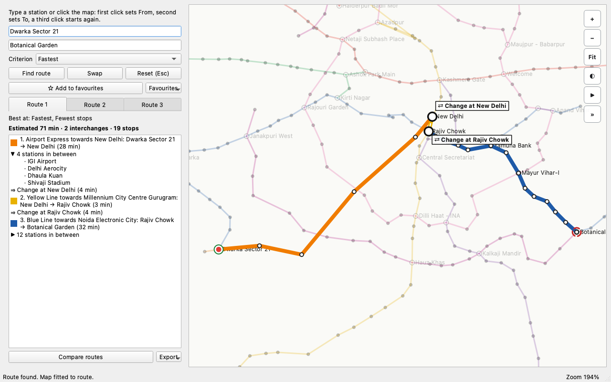
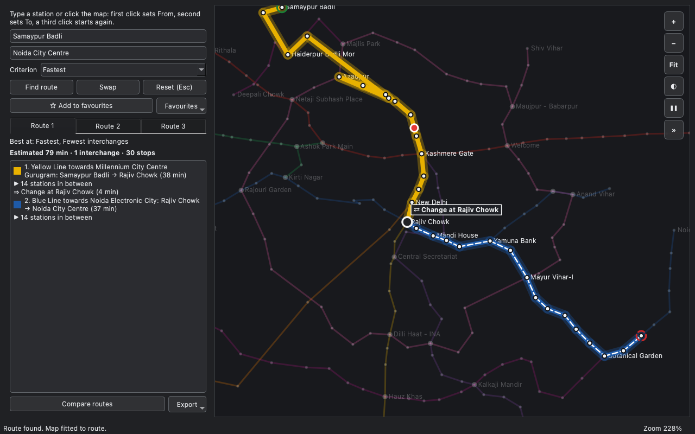
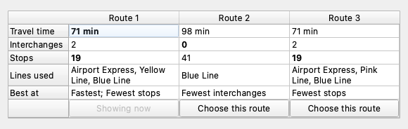
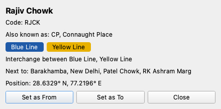

# Delhi Metro Route Planner

Interactive Delhi Metro route planner and visualiser.
CS-3810 Design Practices in CS, Ashoka University — Project 1, Team Starfish (Sanjana Shenai, Arav Kapoor).



| | |
|---|---|
|  |   |

*Left: dark theme with the route animation running. Right: the comparison of three routes and a station card. All three were captured from the program itself.*

## Features

**Core** (Must and Should tiers)

| Feature | Where to see it |
|---|---|
| Search stations by name or code, with typo tolerance and "Did you mean" | the From and To boxes |
| Fastest route, with legs, directions, interchanges and walkways | route panel |
| Fewest interchanges and fewest stops as other criteria | Criterion box |
| Zoomable, pannable map with station labels that appear as you zoom | map |
| Click stations on the map to fill From and To; hover for a tooltip | map |
| Route drawn over the dimmed network; click a leg to zoom to it | map and panel |
| Search runs on a worker thread; stale results are dropped; Retry after a timeout | window |
| Every data problem reported at start-up, not just the first | start-up dialog |
| Keyboard use throughout, accessible names on every control, colour is never the only cue | whole app |

**Optional** (Could tier, added after the feature freeze; see `docs/decisions.md` D47–D59)

| Feature | How to use it |
|---|---|
| Stations along each leg | click **▶ N stations in between** (or press Enter on it) |
| Route highlight: a dot on every route station and a ringed **⇄ Change at …** badge | automatic when a route is shown |
| Alternative routes | **Route 1 / 2 / 3** tabs under the criterion; the caption says what each is best at |
| Route comparison | **Compare routes** under the route list |
| Favourite routes | **☆ Add to favourites**, then the **Favourites** menu |
| Route animation | **▶** on the map or Space; **»** or `.` and `,` to step between stations |
| Station details | right-click a station, or **Ctrl+I** |
| Dark and light themes | **◐** on the map; the choice is remembered |
| Route export | **Export**: copy to clipboard, save as text, save as Markdown |
| Visible zoom and fit buttons; overlapping labels hidden | map buttons **+ − Fit**; automatic |
| New search when the criterion changes | Criterion box |

## Setup

Requires Python 3.12.

```bash
pip install -e ".[test]"
```

## Run

```bash
python main.py
```

The log goes to `metro.log` in the current folder. If that folder cannot be written to, it goes to `%APPDATA%\DelhiMetroPlanner\` on Windows, `~/Library/Logs/DelhiMetroPlanner/` on macOS, or `~/.local/state/DelhiMetroPlanner/` on Linux, and to the console as a last resort.

The theme and favourite routes are kept in `Starfish/DelhiMetroPlanner.ini` (`%APPDATA%` on Windows, `~/.config` on macOS and Linux). Delete that file to reset them.

## Keyboard

| Key | Does |
|---|---|
| Tab / Shift+Tab | move through From, To, Criterion, the buttons, the favourites controls, the route list and the map |
| Enter | choose the highlighted suggestion; search; open or close a station list |
| Esc | close the suggestion list; otherwise reset |
| Alt+W | swap From and To |
| Alt+C | go to the Criterion box |
| Ctrl+I | station card for the To station (or the From station) |
| `+` `-` `0` | on the map: zoom in, zoom out, fit the whole network |
| Space, `.`, `,` | on the map: play or pause the animation, step to the next or previous station |
| Right-click | on a station: details, set as From, set as To |

## Test

```bash
pytest                 # everything (390 tests; the all-pairs check takes about a minute)
pytest -m "not slow"   # skip the all-pairs oracle on the real data
ruff check .           # lint
pytest --cov=metro --cov-report=term-missing   # coverage, 97% at the last run
```

The tests run without a screen (`QT_QPA_PLATFORM=offscreen`) and never touch your saved preferences.

## Command-line routing

```bash
python tools/route_cli.py data "Rajiv Chowk" "Hauz Khas"
python tools/route_cli.py data "Dwarka Sector 21" "Botanical Garden" fewest_changes
python tools/route_cli.py data "Rajiv Chowk" "Hauz Khas" --stations   # list every station passed
python tools/measure_ui.py                                            # memory and drawing time
```

## Desktop build (optional)

```bash
pip install -e ".[build]"
pyinstaller packaging/metro.spec   # output in dist/DelhiMetroPlanner/
```

## Updating the network data

Edit the CSV files in `data/source/`, then regenerate the JSON and re-run the tests:

```bash
python tools/csv_to_json.py data/source data
pytest
```

See `data/README.md` for where each field comes from and what is still unverified.

## Project layout

```
main.py            start-up: logging, load the data, open the window
metro/             the core (never imports Qt): data, graph, routing, alternatives, search, state
metro/ui/          the Qt interface: window, panels, map, dialogs, themes
data/              the network as CSV (source) and JSON (generated)
tools/             route_cli.py, csv_to_json.py, measure_ui.py
tests/             unit, GUI and oracle tests
docs/              architecture, decisions, algorithms, data, performance, usability, demo, viva notes
```

`docs/architecture.md` has the layer diagram and the flow of one search.

## Documents

| File | Content |
|---|---|
| `docs/architecture.md` | layers, one search step by step, file map, decision index |
| `docs/decisions.md` | every change from the A3 design with its reason (D26–D59) |
| `docs/algorithms.md`, `docs/data_repr.md` | the algorithms and how data is represented |
| `docs/performance.md` | measured speed, memory, drawing time and coverage, with what was not measured |
| `docs/demo.md` | a 12-scenario demo script |
| `docs/usability.md` | the usability protocol (results still to be collected) |
| `docs/VIVA.md` | what each step built, and likely questions with answers |
| `PRD.md` | the requirements and build plan |

## Status

What is done, and what the team still has to do. Items are ticked only if they are true of this repository today.

- [x] All Must, Should and the listed Could features are built, with tests (390 passing, lint clean)
- [x] The core imports no Qt (`tests/test_imports.py`)
- [x] Coverage at 97%, over the 95% target
- [x] Route query, search, alternatives and drawing times inside their budgets (`docs/performance.md`)
- [ ] **Station data checked against the official DMRC map.** All 244 stations are still `"verified": false` and the 30 golden routes `"checked": false`; the flags are for the team to set after checking, not to be set in bulk (`data/README.md`)
- [ ] **Memory under 150 MB.** Measured 162–200 MB on macOS; not measured on Windows or Linux (`docs/performance.md`)
- [ ] **Usability sessions with participants and the SUS score** (`docs/usability.md` has the protocol; no results exist yet)
- [ ] Manual smoke test on Windows, macOS and Linux (A3 M5)
- [ ] Demo scenarios 1–6 checked against A3 §8
- [ ] Release tag `v1.0` (PRD step 10)
