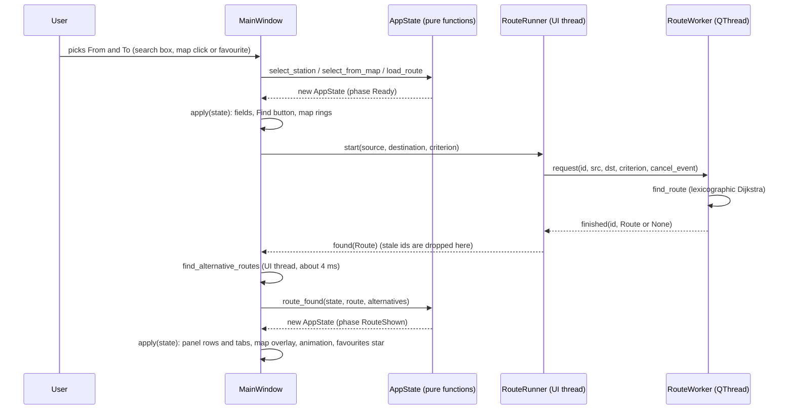

# Architecture

How the program is put together, and where to look for each piece. Decisions D26 onwards are written out in `decisions.md`; this file only points at them.

## The layers

```
 data/source/*.csv ──tools/csv_to_json.py──▶ data/*.json
                                                  │
                                    metro/data.py + metro/validate.py
                                    load_network: reports EVERY problem at once
                                                  ▼
 ┌──────────────────────── CORE  (metro/*.py, never imports Qt) ───────────────────────┐
 │                                                                                      │
 │   Network ──build_graph──▶ RoutingGraph ──find_route──▶ Route                        │
 │   (frozen)   graph.py        one node per      router.py   legs + interchanges      │
 │                              (station, service)               │                      │
 │                                    ▲                          ├─▶ describe.py        │
 │       alternatives.py ─────────────┘                          │   text, export,      │
 │       masks arcs, calls find_route                            │   station facts      │
 │                                                               ▼                      │
 │   search.py        favorites.py        app_state.py:  AppState (frozen) + pure       │
 │   station search   saved journeys      update functions; `phase` is derived         │
 └──────────────────────────────────────────────────────────────────────────────────────┘
                     ▲  only Network, Route and AppState cross this line  ▲
 ┌──────────────────────── UI  (metro/ui/*.py, Qt / PySide6) ──────────────────────────┐
 │                                                                                      │
 │   MainWindow ── turns each user action into an AppState update, then apply() redraws │
 │     │   ├─ SidePanel: SearchBox ×2, criterion, Find/Swap/Reset, FavoritesBar,        │
 │     │   │             Banner, RoutePanel (tabs, leg rows, station lists, Compare,    │
 │     │   │             Export)                                                        │
 │     │   ├─ MapView:  network_items, map_labels, RouteOverlay, RouteAnimator,         │
 │     │   │            MapControls, station_menu                                       │
 │     │   ├─ ExtrasMixin: handlers for favourites, tabs, comparison, export, theme,    │
 │     │   │               station card;  dialogs: StationDialog, RouteCompareDialog    │
 │     │   └─ RouteRunner ──signal──▶ RouteWorker on a QThread  ──▶ find_route          │
 │     └─ theme.py (colours + style sheets), app_settings.py (.ini)                     │
 └──────────────────────────────────────────────────────────────────────────────────────┘
```

Two rules hold the layers apart, and a test checks the first: **the core never imports PySide6** (`tests/test_imports.py`), and **the UI never changes an `AppState`, it makes a new one**. Everything the window shows is a function of the current state, so `MainWindow.apply(state)` is the single place that makes widgets match it.

## One search, step by step



A newer request cancels the older one and bumps the request number, so a slow answer that arrives late is ignored. A search that takes more than 2 seconds is abandoned and the banner offers Retry.

## Where each file fits

**Core (`metro/`)**

| File | What it does |
|---|---|
| `models.py` | Frozen dataclasses: `Station`, `Line`, `Service`, `Segment`, `Network`, `Leg`, `Interchange`, `Route` |
| `errors.py`, `data.py`, `validate.py` | Read and check the JSON; `load_network` reports every problem together |
| `graph.py` | `build_graph` (one node per station and service, so a change of train is a real arc); `interchange_stations` |
| `router.py` | `find_route` and `assemble_route`; criteria are key functions in `KEY_FUNCTIONS` |
| `alternatives.py` | `find_alternative_routes`, `route_badges`; calls `find_route` on a graph with arcs masked |
| `search.py` | Ranked station search with a typo tolerance |
| `describe.py` | Text for legs and interchanges, `route_steps`, export text, `station_details` |
| `favorites.py` | The saved-journeys list and its safe JSON `decode` |
| `app_state.py` | `AppState` and the pure functions that change it |
| `console.py` | UTF-8 output for a Windows console |

**UI (`metro/ui/`)**

| File | What it does |
|---|---|
| `main_window.py`, `extras.py` | The window and its handlers; `ExtrasMixin` holds those of the optional features |
| `side_panel.py`, `search_box.py`, `route_panel.py`, `favorites_bar.py` | The left column and its parts |
| `map_view.py`, `network_items.py`, `map_labels.py`, `map_controls.py`, `station_menu.py` | The map and what is drawn on it |
| `route_overlay.py`, `route_animation.py` | The route on the map and the moving marker |
| `station_dialog.py`, `compare_dialog.py` | The station card and the route comparison |
| `export.py`, `theme.py`, `app_settings.py` | Saving a route, the two themes, what is remembered |
| `worker.py` | `RouteWorker` and `RouteRunner`: the thread, the request number, the watchdog |

## Decisions the repository itself describes

A2 holds D1–D14 and A3 holds D15–D25. Those PDFs are not in this repository, so this table lists only what the PRD, code and other docs say about them. D7, D8, D10–D13, D15 (beyond its use in [D28]) and D23 are described in A2/A3 only.

| ID | What the repository says | Where |
|---|---|---|
| D1 | A closed station gets no node, so it cuts its service | `graph.py` |
| D2 | Walkways are arcs between two stations, both ways unless `one_way` | `graph.py` |
| D3 | `cost` and `prev` are dictionaries, so a query touches only what it explores | `router.py` |
| D4 | Every collection is in sorted-ID order, so ties break the same way every time | `data.py`, `graph.py` |
| D5 | The search checks a cancel event every 256 pops | `router.py`, `worker.py` |
| D6 | A trie for search (A2); replaced by a linear scan in [D26] | `search.py` |
| D9 | Cited for the threading of searches (PRD §6.5 and `worker.py`); the search runs on a worker thread | `worker.py` |
| D14 | A loop has no terminus, so its direction label names the next interchange | `router.py` |
| D16 | Fuzzy matching: none below 3 characters, 1 edit for 3–5, 2 from 6 | `search.py` |
| D17 | A walk costs as a change; walks at the ends are WALK legs, a walk between rides is an interchange | `router.py` |
| D18 | Cited for how the tests run; timings use `perf_counter` and p95 | `tests/test_performance.py`, `performance.md` |
| D19 | Errors are inline, not modal; the start-up data error is the one exception | `route_panel.py`, `main.py` |
| D20 | Accessibility baseline: names on every control, colour is never the only cue, full keyboard use | `tests/test_gui.py` |
| D21 | Labels by zoom tier: interchanges, then terminals, then all | `map_labels.py` |
| D22 | Golden routes check structure only (lines and interchange stations) | `tests/golden/routes.json` |
| D24 | Scope tiers Must, Should, Could | `PRD.md` §2.1 |
| D25 | Think-aloud and SUS results are written by the team | `usability.md` |

D26–D46 are the simplifications and build decisions, and D47–D59 the optional features, all in `decisions.md`.

## Where to change things

- **A new criterion:** one key function in `router.py`, one entry in `CRITERION_LABELS` in `describe.py`. The criterion box, favourites and alternatives pick it up from there.
- **New data:** edit `data/source/*.csv`, run `python tools/csv_to_json.py data/source data`, then `pytest`.
- **A new optional feature:** logic in the core if it has any (with no Qt import), a widget in `metro/ui/`, its handler in `extras.py`, and a decision in `decisions.md`.

## Tests

`tests/` mirrors the code: `test_router*.py`, `test_oracle_real.py` (all pairs against networkx, marked `slow`), `test_alternatives.py`, `test_data.py`, `test_search.py` and the rest for the core; `test_gui*.py`, `test_map_labels.py`, `test_route_overlay.py`, `test_route_panel.py`, `test_station_dialog.py`, `test_theme.py`, `test_compare.py`, `test_favorites_ui.py`, `test_export.py`, `test_animation.py` for the UI, which run without a screen (`QT_QPA_PLATFORM=offscreen`). `tests/conftest.py` gives every test its own empty settings folder so no test touches real saved preferences.
